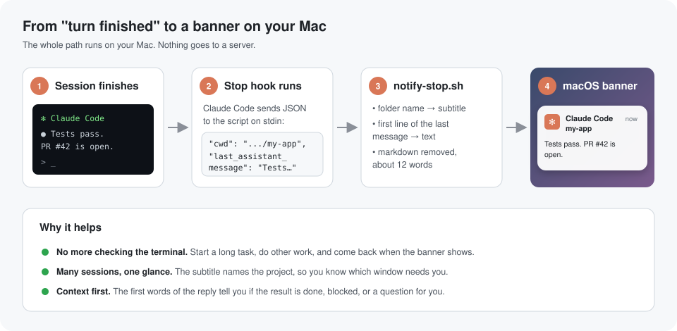

# Claude Code notifications on macOS

Get a macOS notification each time a [Claude Code](https://docs.claude.com/en/docs/claude-code/overview) session finishes its turn. The notification tells you **which project** finished and **what Claude did**, in a few words.



```
┌─────────────────────────────────────┐
│ ✻ Claude Code                  now  │
│   my-app                            │
│   Tests pass. PR #42 is open.       │
└─────────────────────────────────────┘
```

## Why it helps

- **You do not have to watch the terminal.** Give Claude a long task, work on something else, and come back when the banner shows.
- **You can run many sessions.** The subtitle shows the project folder, so you know which session needs you.
- **You see the result first.** The text is the first line of Claude's last reply. It tells you if the task is done, blocked, or if Claude has a question for you.
- **It is small and local.** It is one shell script and one entry in your Claude Code settings. It uses only tools that macOS already has, plus `jq`. Nothing goes to a server.

## Requirements

- macOS
- Claude Code
- [`jq`](https://jqlang.github.io/jq/): `brew install jq`

## Install as a plugin (recommended)

In Claude Code, run:

```
/plugin install mac-notifications --marketplace waracci/claude-code-mac-notifications
```

On Claude Code versions before 2.1.275, add the marketplace first:

```
/plugin marketplace add waracci/claude-code-mac-notifications
/plugin install mac-notifications@waracci
```

The plugin adds the `Stop` hook for every session on your Mac. It does not change your `settings.json`. To turn it off, use `/plugin` and disable or uninstall `mac-notifications`.

Use the plugin **or** the script installer below. Do not use both, or you get two banners for each finish.

## Install with the script

```bash
git clone https://github.com/waracci/claude-code-mac-notifications.git
cd claude-code-mac-notifications
./install.sh
```

The installer does these steps:

1. It copies `hooks/notify-stop.sh` to `~/.claude/hooks/`.
2. It makes a backup of `~/.claude/settings.json`.
3. It adds one `Stop` hook to `~/.claude/settings.json`. It keeps all your other settings and hooks.
4. It shows a test notification.

You can run the installer again. It does not add the hook two times. It only updates the script.

The hook is in your **user** settings, so it works for every Claude Code session on your Mac, in every project. New sessions use it immediately. If a session is already open, type `/hooks` in it one time to load the new hook, or restart the session.

### Manual install

If you do not want to run the installer, copy the script:

```bash
mkdir -p ~/.claude/hooks
cp hooks/notify-stop.sh ~/.claude/hooks/
chmod +x ~/.claude/hooks/notify-stop.sh
```

Then add this to `~/.claude/settings.json`. If you already have a `hooks` object, add only the `Stop` entry to it:

```json
{
  "hooks": {
    "Stop": [
      {
        "hooks": [
          {
            "type": "command",
            "command": "bash ~/.claude/hooks/notify-stop.sh 2>/dev/null || true",
            "timeout": 10
          }
        ]
      }
    ]
  }
}
```

## Ack button and one banner per session (optional)

The default banner comes from `osascript`. macOS shows it as a **Script Editor** notification. Its only button is **Show**, and **Show** opens Script Editor.

For a better banner, install [alerter](https://github.com/vjeantet/alerter). Put the binary in `~/.claude/bin/alerter` or anywhere on your `PATH`. The script finds it and then:

- shows an **Ack** button that only closes the banner,
- keeps one banner for each session: a new finish replaces the old banner of the same session,
- does not wait for your click: the hook still ends at once.

To make the banners stay until you click **Ack**, go to **System Settings → Notifications → alerter**. Set the banner style to **Persistent**. To see each banner on its own, and not in one stack, set **Notification grouping** to **Off**.

## How it works

1. When a session finishes its turn, Claude Code runs every `Stop` hook. It sends the hook a JSON object on stdin. The object includes `cwd` (the project folder), `transcript_path`, and, in newer versions, `last_assistant_message`.
2. `notify-stop.sh` reads the folder name. It reads the last message from `last_assistant_message`. If that field is missing, it reads the last message from the end of the transcript file.
3. The script keeps the first line that has text, removes the markdown symbols, and keeps about 12 words.
4. If `alerter` is installed, it shows the notification with an **Ack** button. The script starts it in the background, so the hook does not wait. If `alerter` is not installed, `osascript` shows the notification. The script gives the text to AppleScript as arguments and not inside the script code. Thus quotes or `$(...)` in a message cannot break the command or run code.
5. The hook always ends with exit code 0, so it can never block or change your session.

A subagent that finishes does not send a notification. Only the main session does.

## Settings

Set these environment variables in your shell profile, or in the `env` object of `~/.claude/settings.json`:

| Variable | Default | What it does |
|---|---|---|
| `CLAUDE_NOTIFY_SOUND` | `Glass` | The sound name. Other names are in `/System/Library/Sounds`, for example `Ping` or `Submarine`. Set it to an empty value for no sound. |
| `CLAUDE_NOTIFY_WORDS` | `12` | How many words of the last message to show. |
| `CLAUDE_NOTIFY_ACK` | `Ack` | The button text when `alerter` is installed. |
| `CLAUDE_NOTIFY_ALERTER` | (none) | The full path to `alerter`, if it is not in `~/.claude/bin` or on your `PATH`. |

## Privacy

- The notification shows the first words of Claude's reply. Your lock screen can show notifications too. If your work is private, go to **System Settings → Notifications → Show previews** and select **When Unlocked**.
- The script sends no data from your Mac. It reads the hook input and the local transcript only.
- The script writes no files and keeps no logs.

## No notification shows

- **Allow the notifications.** `osascript` notifications come from **Script Editor**. Go to **System Settings → Notifications → Script Editor**, and turn on **Allow notifications**. On some macOS versions they come from your terminal app. Run the test below one time to make the entry show in the list.
- **Check Focus.** Do Not Disturb and the other Focus modes hide banners.
- **Test the script directly:**
  ```bash
  echo '{"cwd":"/tmp/demo","last_assistant_message":"Hello from the hook."}' | bash ~/.claude/hooks/notify-stop.sh
  ```
- **Check that the hook is installed:** type `/hooks` in Claude Code, or run:
  ```bash
  jq '.hooks.Stop' ~/.claude/settings.json
  ```

## Too noisy?

- To remove only the sound, set `CLAUDE_NOTIFY_SOUND=""`.
- To turn the hook off for some time, use `/hooks` in Claude Code. If you use the plugin, disable it with `/plugin`.
- To remove it completely, run:
  ```bash
  ./uninstall.sh
  ```
  The uninstaller makes a backup of your settings. It removes only this hook and the script.

## Files

```
.claude-plugin/         the plugin manifest, the marketplace file and the icon
hooks/hooks.json        the Stop hook for the plugin
hooks/notify-stop.sh    the Stop hook script
install.sh              installs the script and adds the hook to your settings
uninstall.sh            removes them again
docs/how-it-works.svg   the diagram above
```

## License

MIT. See [LICENSE](LICENSE).
